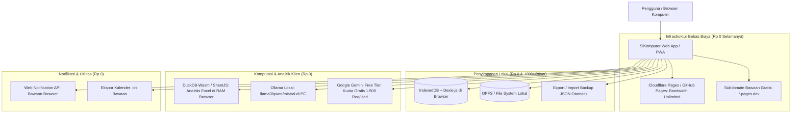

# Estimasi Biaya — Arsitektur 100% Gratis (Zero-Cost / Rp 0 Selamanya)

Dokumen ini memuat perencanaan infrastruktur, rincian teknis, dan strategi implementasi untuk memastikan aplikasi **SiKomputer** dapat dibangun, di-deploy, dan dioperasikan secara **penuh tanpa biaya (Rp 0 selamanya)**, tanpa ketergantungan pada layanan pihak ketiga berbayar (*Zero Paid Third-Party Dependencies*).

---

## 1. Filosofi Arsitektur: "Local-First & Zero-Cost Stack"

Untuk mencapai status operasional **Rp 0 (Full Gratis)**, arsitektur SiKomputer dirancang dengan model **Local-First & Client-Side Architecture**. 

Semua pemrosesan data, penyimpanan, analitik, dan notifikasi dimaksimalkan pada sumber daya perangkat pengguna (*client-side compute*) dan layanan hosting statis gratis tanpa batas:

---

## 2. Rincian Komponen Bebas Biaya (Zero-Cost Breakdown)

Berikut adalah komparasi penggantian layanan berbayar menjadi alternatif 100% gratis:

| Pos Kebutuhan | Solusi Layanan Berbayar | **Solusi SiKomputer 100% Gratis (Rp 0)** | Teknologi / Penyedia | Biaya Bulanan |
|---|---|---|---|---|
| **Hosting Aplikasi Web** | Vercel Pro ($20/bln) | **Cloudflare Pages / GitHub Pages** | Static Site Hosting (Bandwidth Unlimited, SSL gratis) | **Rp 0** |
| **Domain & Sertifikat SSL** | Domain kustom tahunan ($12/thn) | **Subdomain Bawaan Resmi** | Subdomain `*.pages.dev` + SSL Otomatis | **Rp 0** |
| **Database Server** | Supabase Pro ($25/bln) | **Local-First (IndexedDB + Dexie.js)** | Penyimpanan di browser pengguna, tanpa server database | **Rp 0** |
| **Penyimpanan File** | AWS S3 / Cloudflare R2 | **Origin Private File System (OPFS)** | Menggunakan hard drive / SSD lokal perangkat pengguna | **Rp 0** |
| **Pemrosesan Excel** | Server Python/Pandas di VPS | **DuckDB-Wasm & SheetJS** | Analisis SQL langsung di memori browser via WebAssembly | **Rp 0** |
| **Kecerdasan Buatan (MoM & AI)**| Langganan OpenAI API / Claude | **Ollama Lokal / Gemini Free Tier** | 1. Ollama lokal (`localhost:11434`, 100% offline & gratis) 2. Gemini Free Tier (1.500 request/hari gratis) | **Rp 0** |
| **Layanan Pengiriman Email** | Resend / SendGrid berbayar | **Browser Notification API & Ekspor .ics** | Pop-up notifikasi desktop native + integrasi kalender file | **Rp 0** |
| **Proxy API Tester** | Server VPS Proxy ($5-$10/bln) | **Ekstensi Browser / Cloudflare Worker Free** | Kuota gratis 100.000 request per hari atau ekstensi CORS | **Rp 0** |
| **Pemantauan Error (Logs)** | Sentry ($26/bln) | **Local Diagnostic Session Log** | Riwayat error disimpan secara lokal di sesi browser | **Rp 0** |
| **Distribusi Mobile** | Biaya Apple Developer ($99/thn) | **Progressive Web App (PWA)** | Install via tombol "Tambahkan ke Layar Utama" di HP | **Rp 0** |
| **TOTAL BIAYA OPERASIONAL** | **~$80 - $150 / bulan** | — | — | **Rp 0 / SELAMANYA** |

---

## 3. Strategi Fitur Cerdas (AI) Tanpa Biaya Pihak Ketiga

Untuk fitur cerdas seperti *MoM Generator*, *Ringkasan YouTube*, dan *Tanya Data Excel*, sistem menggunakan dua jalur tanpa biaya:

### Jalur 1: Model AI Lokal (100% Offline via Ollama) — Paling Direkomendasikan
- Pengguna menjalankan engine **Ollama** di laptop/komputer sendiri (misal model `llama3.2`, `qwen2.5-coder`, atau `mistral`).
- Aplikasi SiKomputer menghubungkan request langsung ke `http://localhost:11434/api/generate`.
- **Keuntungan**:
  - Nol biaya token selamanya.
  - Berjalan tanpa internet.
  - Kerahasiaan data rapat dan dokumen 100% terjaga di perangkat pribadi.

### Jalur 2: Google Gemini API Free Tier (Cloud Gratis)
- Pengguna membuat API Key gratis di Google AI Studio (*zero credit card required*).
- **Kuota Bebas Biaya**:
  - 15 Request per menit (RPM).
  - 1.500 Request per hari (RPD).
  - 1.000.000 Token per menit (TPM).
- **Evaluasi**: Kuota harian ini sangat melimpah untuk kebutuhan personal (penggunaan rata-rata hanya 15–40 request per hari).

---

## 4. Panduan Deploy Aplikasi Bebas Biaya (Cloudflare Pages)

Aplikasi frontend SiKomputer yang telah selesai dapat dipublikasikan ke internet secara gratis dalam 3 langkah mudah:

1. **Unggah Repositori ke GitHub**:
   Inisialisasi git dan push kode ke GitHub personal Anda (repositori privat maupun publik).
2. **Koneksikan ke Cloudflare Pages**:
   - Buka dasbor [Cloudflare Pages](https://pages.cloudflare.com/) (buat akun gratis).
   - Pilih *Connect to Git* dan pilih repositori `SiKomputer`.
3. **Pengaturan Build**:
   - **Framework Preset**: `Vite`
   - **Build Command**: `npm run build`
   - **Build Output Directory**: `dist`
4. **Selesai**:
   Aplikasi Anda langsung aktif di URL permanen gratis (misal: `https://sikomputer.pages.dev`) lengkap dengan HTTPS otomatis dan perlindungan DDoS.

---
*Rancangan ini menjamin bahwa Anda memiliki aplikasi produktivitas yang tangguh, modern, dan mandiri tanpa mengeluarkan biaya sepeser pun.*
