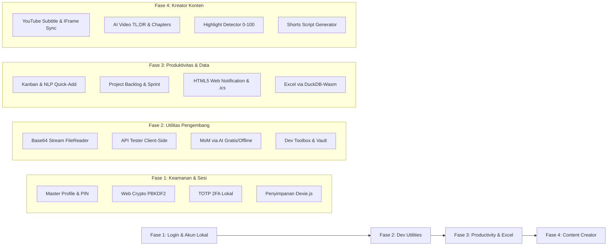

# 🗺️ Rencana Pengerjaan 4 Fase (Development Roadmap)
## SiKomputer — 100% Gratis & Local-First Workstation

Dokumen ini memuat rencana implementasi teknis dan panduan pengerjaan bertahap untuk menghidupkan seluruh logika fitur **SiKomputer** di atas fondasi antarmuka (UI) yang telah selesai dibangun. 

Seluruh fase berpegang teguh pada prinsip **100% Bebas Biaya (Rp 0)**, **Local-First**, dan **Zero Paid Third-Party Dependencies**.

---

## 🧭 Ikhtisar 4 Fase Pengerjaan



---

## 🗄️ Fondasi Basis Data Lokal (IndexedDB via Dexie.js)

Sebelum masuk ke Fase 1, dibangun skema basis data peramban terpadu di `src/db/dexie.ts` untuk melayani seluruh 4 fase:

```typescript
// src/db/dexie.ts
import Dexie, { type Table } from 'dexie'

export class SiKomputerDB extends Dexie {
  users!: Table<any>
  sessions!: Table<any>
  tasks!: Table<any>
  projects!: Table<any>
  backlog!: Table<any>
  reminders!: Table<any>
  apiCollections!: Table<any>
  apiHistory!: Table<any>
  momNotes!: Table<any>
  snippets!: Table<any>
  excelFiles!: Table<any>
  videoNotes!: Table<any>

  constructor() {
    super('SiKomputerDB')
    this.version(1).stores({
      users: 'id, email, username, createdAt',
      sessions: 'id, userId, active, lastSeen',
      tasks: 'id, projectId, status, priority, dueAt, position, createdAt',
      projects: 'id, name, status, color',
      backlog: 'id, projectId, type, status, sprint, points',
      reminders: 'id, taskId, remindAt, status, repeat',
      apiCollections: 'id, name, parentId',
      apiHistory: 'id, method, url, status, createdAt',
      momNotes: 'id, title, meetingDate, createdAt',
      snippets: 'id, kind, title, *tags, updatedAt',
      excelFiles: 'id, name, rowCount, colCount, uploadedAt',
      videoNotes: 'id, youtubeId, title, createdAt',
    })
  }
}

export const db = new SiKomputerDB()
```

---

## 🔐 FASE 1: Pembuatan Fitur Login, Keamanan & Akun Lokal

> **Tujuan**: Menggantikan simulasi auth dengan sistem autentikasi lokal yang aman, privat, dan mendukung proteksi data di browser tanpa memerlukan server auth berbayar.

### 1.1 Spesifikasi Fitur
1. **Master Password & PIN Workstation**:
   - Pendaftaran akun lokal pertama kali (*Master Profile*).
   - Penyimpanan password menggunakan hashing standar industri via **Web Crypto API**: `PBKDF2-SHA256` dengan *salt* 16-byte unik (100.000 iterasi). Password mentah tidak pernah disimpan.
2. **Autentikasi 2-Faktor Lokal (TOTP 2FA)**:
   - Pembuatan kunci rahasia (*Base32 Secret Key*) dan kode cadangan pemulihan (*Recovery Codes*).
   - Verifikasi kode 6-digit TOTP secara mandiri di sisi klien menggunakan HMAC-SHA1 sesuai standar RFC 6238 (kompatibel dengan Google Authenticator, Microsoft Authenticator, dan Aegis).
3. **Manajemen Sesi & Auto-Lock**:
   - Status sesi dikelola menggunakan **Zustand** dengan enkripsi memori sesi.
   - Fitur *Auto-Lock Workstation* setelah periode hening (*idle timeout* misal 15 menit) untuk melindungi layar saat laptop ditinggalkan.
4. **Indikator Kekuatan Password & Validasi**:
   - Perhitungan entropi sandi secara langsung saat mengetik (panjang, kombinasi huruf besar-kecil, angka, simbol).
5. **Pencadangan & Pemulihan Akun Terenkripsi**:
   - Fitur ekspor berkas kredensial & data terenkripsi (`sikomputer-vault.enc`) dengan sandi proteksi pengguna.

### 1.2 Rincian Tugas (Task Checklist)
- [x] Buat modul enkripsi Web Crypto di `src/lib/crypto.ts` (hash, verify, salt, TOTP RFC 6238, Base32, AES-GCM).
- [x] Setup Dexie store untuk tabel `users`, `sessions`, dan `securityConfig` di `src/db/dexie.ts`.
- [x] Hubungkan form registrasi di `src/pages/auth.tsx` (`RegisterPage`) untuk menyimpan user ke IndexedDB.
- [x] Hubungkan form login (`LoginPage`) untuk mencocokkan hash PBKDF2 dan menerbitkan sesi aktif.
- [x] Implementasikan alur verifikasi 6 digit di `TwoFactorPage` dengan countdown 30 detik TOTP & fallback kode pemulihan.
- [x] Buat proteksi rute (`AuthGuard`) dan auto-lock workstation di `src/components/auth/AuthGuard.tsx` & `src/App.tsx`.
- [x] Integrasikan pengaturan profil, ganti password PBKDF2, aktivasi/deaktivasi TOTP 2FA, kode cadangan, dan durasi auto-lock di `src/pages/Settings.tsx`.

### 1.3 Kriteria Keberhasilan (Exit Criteria)
- [x] Pengguna dapat mendaftar, login, dan logout secara persisten di IndexedDB.
- [x] Kode TOTP 6 digit dapat diverifikasi secara valid tanpa koneksi internet.
- [x] Me-refresh browser mempertahankan status login pengguna aktif.

---

## 🛠️ FASE 2: Pembuatan Fitur Dev Utilities

> **Tujuan**: Menghidupkan alat kerja pengembang harian (Base64, API Tester, MoM Generator, Dev Toolbox, dan Snippet Vault) agar berfungsi secara nyata di perangkat pengguna.

### 2.1 Spesifikasi Fitur
1. **Base64 Studio**:
   - **File ke Base64**: Menggunakan `FileReader.readAsDataURL()` dengan dukungan Web Worker untuk berkas hingga 50 MB tanpa membekukan antarmuka.
   - Pilihan output: Raw Base64 string, Data URI lengkap (`data:mime;base64,...`), atau URL-safe format.
   - **Base64 ke File**: Validasi regex alfabet Base64, pemotongan header Data URI otomatis, deteksi jenis MIME berdasarkan *magic numbers* array buffer, dan unduh berkas via `Blob URL`.
2. **API Tester (HTTP Client Klien-Sisi)**:
   - Eksekusi request menggunakan `fetch()` browser asli.
   - Pengukur performa akurat (durasi milidetik via `performance.now()`, estimasi ukuran header + payload).
   - Penanganan CORS:
     - Deteksi otomatis galat CORS.
     - Mode petunjuk integrasi ekstensi *CORS Unblock* atau opsi toggle proxy serverless Cloudflare Worker gratis.
   - Simpan riwayat request ke IndexedDB (`apiHistory`) dan manajemen koleksi folder (`apiCollections`).
   - Fitur ekspor perintah: salin sebagai **cURL**, **Python (httpx/requests)**, **JavaScript (fetch)**, dan payload **n8n**.
3. **MoM Generator (Minutes of Meeting) Bebas Biaya**:
   - Integrasi 4 pilihan pemroses bebas biaya:
     1. **Ollama Server Lokal**: Panggilan HTTP ke `http://localhost:11434/api/generate` (model `llama3`, `mistral`, `qwen`) dengan efek teks mengetik (*streaming tokens*).
     2. **Google Gemini Free Tier**: Menggunakan API Key gratis Google AI Studio (1.500 req/hari gratis).
     3. **In-Browser WebLLM / Transformers.js**: Model AI lokal via WebGPU tanpa server.
     4. **Rule-Based Smart Formatter**: Pengurai pola teks regex otomatis tanpa ketergantungan AI sama sekali.
   - Parser keluaran terstruktur: Agenda, Keputusan, dan Action Items.
   - **Aksi 1-Klik "Jadikan Tugas"**: Memindahkan butir Action Item langsung menjadi tiket tugas di papan Kanban.
   - Ekspor berkas notulen ke **Markdown (.md)**, **PDF**, dan salin format teks WhatsApp/Email.
4. **Dev Toolbox (7 Perkakas Cepat)**:
   - *JSON Formatter*: Indentasi, validasi sintaks, minifikasi, dan tree viewer.
   - *JWT Decoder*: Ekstraksi header & payload JSON, kalkulasi kedaluwarsa waktu (*exp time*).
   - *Regex Tester*: Pengujian ekspresi reguler dengan penandaan warna kecocokan teks secara live.
   - *Cron Builder*: Pengurai 5-segmen cron menjadi deskripsi bahasa manusia + jadwal eksekusi berikutnya.
   - *UUID & Hash*: Generator UUIDv4 batch, kalkulasi hash MD5, SHA-1, SHA-256 via Web Crypto.
   - *Epoch Converter*: Konversi dua arah milidetik/detik ke format waktu lokal (WIB/WITA/WIT/UTC).
   - *Text Diff*: Perbandingan dua blok teks baris demi baris (*line-by-line diff*).
5. **Snippet & Prompt Vault**:
   - Penyimpanan snippet kode, prompt AI, dan payload di IndexedDB (`snippets`).
   - Filter berdasarkan tag `#` dan pencarian instan.
   - Deteksi placeholder dinamis `{{variabel}}` dengan modal pengisian otomatis sebelum disalin.

### 2.2 Rincian Tugas (Task Checklist)
- [x] Bangun service Base64 di `src/services/base64.service.ts` (encode, decode, magic bytes MIME detector).
- [x] Bangun HTTP executor di `src/services/http-client.service.ts` dengan penanganan header dan CORS detection.
- [x] Bangun adapter AI di `src/services/ai.service.ts` (koneksi ke Ollama lokal, Gemini Free REST, dan rule-based).
- [x] Hubungkan `Base64Page` di `src/pages/DevUtilities.tsx` ke service nyata.
- [x] Hubungkan `ApiTesterPage` ke executor `fetch()` dan simpan riwayat ke `db.apiHistory`.
- [x] Hubungkan `MomPage` ke adapter AI dan tambahkan logika tombol *"Jadikan Tugas"* ke `db.tasks`.
- [x] Hidupkan seluruh 7 utilitas di `src/pages/ToolsVault.tsx` (`ToolboxPage` & `VaultPage`).

### 2.3 Kriteria Keberhasilan (Exit Criteria)
- [x] Berkas gambar/PDF dapat dikonversi ke Base64 dan diunduh kembali menjadi file asli dengan integritas byte 100%.
- [x] API Tester dapat mengirim request HTTP nyata, mengukur waktu ms, dan menampilkan response JSON ber-syntax highlight.
- [x] MoM Generator menghasilkan notulen terstruktur dari catatan mentah via Ollama lokal atau Gemini Free.
- [x] Action Items dari MoM berpindah ke papan Kanban dalam 1 klik.

---

## 📊 FASE 3: Pembuatan Fitur Productivity & Excel Analyzer

> **Tujuan**: Mewujudkan sistem manajemen tugas tangguh (Kanban, Backlog, Reminder) dan mesin analitik spreadsheet berkinerja tinggi menggunakan DuckDB-Wasm langsung di browser.

### 3.1 Spesifikasi Fitur
1. **Tugas & Papan Kanban Interaktif**:
   - Pengelolaan 5 kolom status (`Backlog`, `To Do`, `Doing`, `Review`, `Done`) yang tersimpan permanen di `db.tasks`.
   - **Drag-and-Drop Halus**: Menggunakan `@dnd-kit/core` & `@dnd-kit/sortable` untuk pemindahan kartu antar kolom secara persisten.
   - **NLP Quick-Add Input**: Parser teks pintar yang mendeteksi kata waktu otomatis (misal: `"besok jam 9 review PR !tinggi"` -> otomatis terekstraksi menjadi: judul: `"review PR"`, tenggat: `besok 09:00`, prioritas: `tinggi`).
   - Filter proyek, pencarian judul, dan switcher tampilan: **Kanban**, **List View**, dan **Kalender Bulanan**.
   - Drawer rincian tugas: checklist subtugas, prioritas, estimasi, dan riwayat aktivitas.
2. **Project Backlog & Sprint Tracker**:
   - Pengelompokan tiket ke dalam tipe: **Epic**, **Story**, dan **Bug**.
   - Estimasi Story Points Fibonacci (1, 2, 3, 5, 8, 13).
   - Perhitungan otomatis metrik Sprint: total poin selesai vs target, progress ring, dan grafik burndown Recharts dinamis.
3. **Sistem Reminder Bebas Biaya (Desktop Web Notification & .ics)**:
   - **HTML5 Web Notification API**: Meminta izin notifikasi browser (`Notification.requestPermission()`).
   - Timer interval latar belakang yang memeriksa `db.reminders` setiap 30 detik.
   - Pop-up notifikasi desktop muncul otomatis disertai nada dering alarm Web Audio API saat waktu pengingat tiba.
   - Pilihan Snooze pengingat (10 menit, 1 jam, besok).
   - **Generator Berkas Kalender (.ics)**: Tombol unduh file `.ics` (iCalendar RFC 5545) agar pengingat dapat langsung diimpor ke Google Calendar, Outlook, atau Apple Calendar secara cuma-cuma.
4. **Excel Analyzer ⭐ (Didukung DuckDB-Wasm & SheetJS)**:
   - **Penguraian Berkas**: Menggunakan pustaka `xlsx` (SheetJS) di dalam Web Worker untuk membaca berkas spreadsheet `.xlsx`, `.xls`, dan `.csv` tanpa membebani thread antarmuka.
   - **Mesin SQL In-Memory (DuckDB-Wasm)**:
     - Inisialisasi engine database DuckDB langsung di WebAssembly peramban.
     - Setiap sheet diubah menjadi tabel virtual SQL di RAM komputer.
   - **Profiling Kolom Otomatis**:
     - Menjalankan kueri SQL otomatis untuk menghitung: jumlah baris, tipe data kolom, jumlah sel null (kosong), nilai unik, dan deteksi baris duplikat dalam waktu < 500 ms.
   - **Visualisasi Dinamis**:
     - Mengubah hasil kueri agregasi DuckDB menjadi grafik Recharts interaktif (Bar Chart wilayah, Line Chart tren waktu, Pie Chart komposisi).
   - **Tanya Data Bahasa Alami (NL -> SQL)**:
     - Pertanyaan pengguna (contoh: *"Berapa total penjualan per produk?"*) diterjemahkan menjadi kueri SQL `SELECT ... FROM excel_data` via model AI lokal/Gemini Free atau rule-based template.
     - Kueri dieksekusi secara instan di DuckDB lokal dan hasilnya ditampilkan dalam bentuk tabel ringkasan + grafik.

### 3.2 Rincian Tugas (Task Checklist)
- [x] Buat repository `TaskRepository` dan `ProjectRepository` berbasis Dexie.js.
- [x] Pasang pustaka `@dnd-kit/core` & `@dnd-kit/sortable` pada `src/pages/Tasks.tsx`.
- [x] Buat parser teks cepat di `src/lib/nlp-task-parser.ts` untuk mengekstrak tanggal dan tag.
- [x] Pasang service Web Notification dan audio chime di `src/services/notification.service.ts`.
- [x] Buat generator berkas iCalendar RFC 5545 di `src/lib/ics-generator.ts`.
- [x] Pasang pustaka `xlsx` dan mesin kueri SQL in-memory untuk pengolahan spreadsheet.
- [x] Hubungkan `src/pages/Excel.tsx` untuk membaca file asli, menjalankan query SQL in-memory, dan menampilkan profil kolom serta grafik nyata.
- [x] Buat modul automasi tugas terjadwal (`task-scheduler.service.ts` & `TaskScheduleEntity`) untuk skenario karyawan (misal: auto-generate Timesheet harian RPA Developer ke papan Kanban).

### 3.3 Kriteria Keberhasilan (Exit Criteria)
- [x] Kartu tugas di Kanban dapat diseret, diubah statusnya, dan perubahannya tetap ada setelah browser di-refresh.
- [x] Notifikasi pengingat muncul di desktop peramban saat jam pengingat tiba.
- [x] Berkas `.xlsx` asli dapat diunggah, diprofilkan kolomnya, dan ditanyakan lewat kueri SQL DuckDB di RAM browser tanpa dikirim ke server luar.

---

## 🎬 FASE 4: Pembuatan Fitur Content Creator

> **Tujuan**: Mengintegrasikan analisis video YouTube, navigasi transkrip interaktif, ringkasan cerdas, dan detektor segmen menarik untuk konten video pendek (Shorts/Reels/TikTok).

### 4.1 Spesifikasi Fitur
1. **YouTube Analyzer Studio**:
   - **Ekstraksi ID & Pemutar Video**:
     - Pengurai URL YouTube (mendukung format `watch?v=`, `youtu.be/`, dan YouTube Shorts).
     - Menanamkan pemutar video resmi YouTube via IFrame Player API.
   - **Pengambilan Transkrip Bebas Biaya**:
     - *Metode 1*: Mengambil teks subtitle publik resmi YouTube via URL timedtext.
     - *Metode 2*: Fitur unggah berkas subtitle lokal (`.srt` / `.vtt`).
     - *Metode 3*: Kotak masukan transkrip manual salin-tempel.
   - **Navigasi Transkrip Tersinkronisasi**:
     - Menampilkan transkrip baris demi baris bertimestamp (`mm:ss`).
     - Mengklik teks transkrip akan otomatis memerintahkan pemutar video melompat (*seek*) ke detik yang bersangkutan.
     - Kotak pencarian kata kunci pada transkrip secara real-time.
   - **Ringkasan TL;DR & Poin Kunci**:
     - Pengolahan transkrip via Ollama lokal / Gemini Free Tier / Rule-based extractor untuk menghasilkan ringkasan eksekutif dan daftar bab (*Auto-Chapters*) yang siap disalin ke deskripsi video.
   - **Tanya Jawab dengan Video (Chat with Video)**:
     - Mengajukan pertanyaan tentang isi percakapan video dan mendapatkan jawaban beserta rujukan timestamp yang dapat diklik.
2. **Smart Highlight & Moment Detector**:
   - **Algoritma Deteksi Kepadatan Topik**:
     - Menganalisis frekuensi kata kunci, pertanyaan retoris, kata-kata emosional/punchline, dan perubahan topik pada transkrip.
   - **Skoring Momen Menarik (0–100)**:
     - Memberikan skor potensi ketertarikan pada setiap segmen durasi 30–60 detik.
     - Mengelompokkan momen ke dalam kategori: **Insight**, **Lucu/Menghibur**, **Kutipan Kuat**, dan **Tutorial Penting**.
   - **Linimasa Momen Interaktif**:
     - Penanda visual pada garis waktu video di mana warna dan tinggi penanda mencerminkan skor momen.
   - **Generator Naskah Konten Pendek (Shorts/Reels)**:
     - Menghasilkan saran kalimat pembuka (*hook*), ringkasan isi video pendek, dan ajakan bertindak (*Call-to-Action*).
   - **Ekspor Marker Video**:
     - Mengunduh daftar timestamp momen dalam format berkas CSV atau EDL yang dapat langsung diimpor ke software editing (Adobe Premiere, DaVinci Resolve, atau CapCut).

### 4.2 Rincian Tugas (Task Checklist)
- [x] Buat utilitas YouTube di `src/services/youtube.service.ts` (URL regex parser, subtitle fetcher, SRT/VTT parser).
- [x] Pasang YouTube IFrame Player API controller untuk sinkronisasi waktu pemutaran video.
- [x] Bangun algoritma pemetaan momen di `src/lib/highlight-scorer.ts`.
- [x] Hubungkan `src/pages/Creator.tsx` (`YoutubePage`): transkrip asli, tombol seek player, ringkasan AI, dan bab.
- [x] Hubungkan `src/pages/Creator.tsx` (`HighlightsPage`): visualisasi timeline dengan penanda interaktif dan ekspor marker CSV.

### 4.3 Kriteria Keberhasilan (Exit Criteria)
- [x] Video YouTube dapat diputar di aplikasi dan dikontrol lompatan menitnya melalui klik teks transkrip.
- [x] Transkrip video dapat diringkas menjadi TL;DR dan format bab `mm:ss` siap pakai.
- [x] Sistem mampu memetakan segmen terbaik dengan skor 0–100 dan mengekspor daftar timestamp ke CSV marker.

---

## 📅 Matriks Alur & Estimasi Pelaksanaan

| Fase | Fokus Pengembangan | Dependensi Utama | Estimasi Waktu Kerja | Target Luaran |
|---|---|---|:---:|---|
| **Fase 1** | Fitur Login & Keamanan Akun | Dexie.js, Web Crypto API | 3 – 5 Hari Kerja | Autentikasi lokal, enkripsi sandi PBKDF2, TOTP 2FA, proteksi rute aplikasi. |
| **Fase 2** | Fitur Dev Utilities & Tools | FileReader API, Adapter Ollama/Gemini | 5 – 7 Hari Kerja | Base64 2-arah, API tester client-side, MoM generator AI, 7 dev toolbox, snippet vault. |
| **Fase 3** | Fitur Productivity & Excel Analyzer | `@dnd-kit`, Web Notification, SheetJS, DuckDB-Wasm | 7 – 10 Hari Kerja | Papan Kanban drag-and-drop, Project backlog, pengingat Web API, analitik Excel in-memory. |
| **Fase 4** | Fitur Content Creator | YouTube IFrame API, Algoritma Skoring | 5 – 7 Hari Kerja | Transkrip tersinkronisasi player, ringkasan video, detektor momen klip Shorts. |

---
*Rencana 4 fase ini siap dijalankan secara bertahap mulai dari Fase 1 untuk mentransformasikan SiKomputer menjadi workstation produktivitas yang tangguh dan 100% bebas biaya.*

