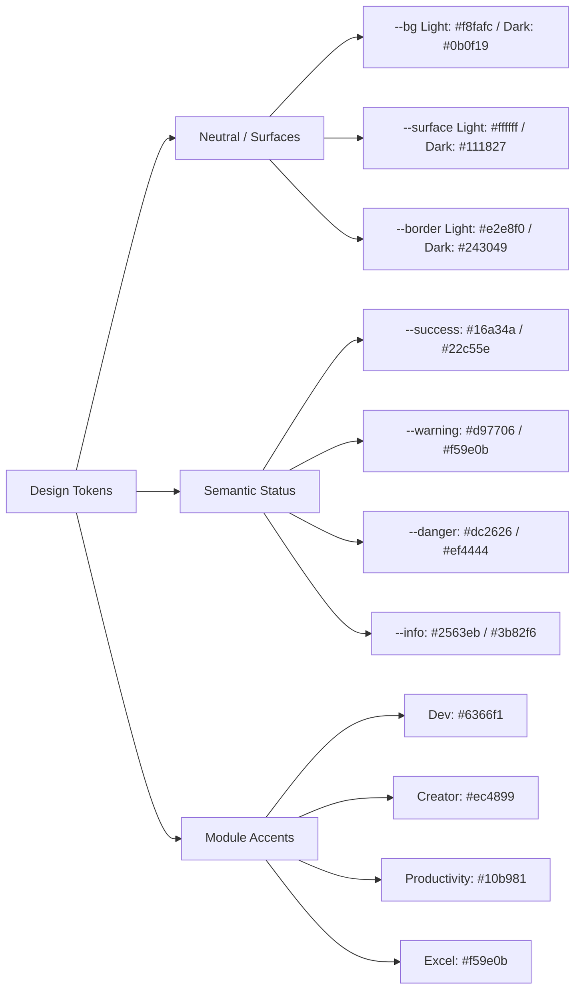
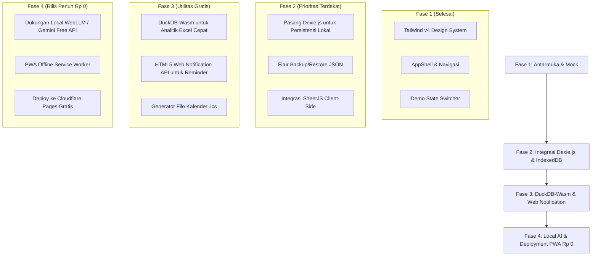

# Perencanaan Antarmuka Pengguna (UI/UX Plan) — SiKomputer
## Versi Arsitektur: 100% Gratis & Local-First (Zero-Cost / Rp 0)

Dokumen ini memuat arsitektur visual, filosofi interaksi, fondasi *design system*, serta blueprint antarmuka pengguna (UI/UX) untuk platform **SiKomputer** yang dioptimalkan untuk beroperasi **100% gratis tanpa ketergantungan pada layanan pihak ketiga berbayar**.

---

## 1. Visi Desain & Filosofi Interaksi

### 1.1 Visi Utama: "Private, Local-First, Zero-Cost Workstation"
SiKomputer dirancang sebagai wadah kerja terpadu bagi rekayasawan perangkat lunak, manajer teknis, analis data, dan kreator konten dengan prinsip:
1. **100% Gratis Selamanya**: Tidak membutuhkan biaya sewa database cloud, server analitik, atau langganan API berbayar.
2. **Kedaulatan Data Penuh (Data Privacy)**: Seluruh data tugas, berkas Excel, catatan rapat, dan payload tersimpan di perangkat lokal pengguna (*IndexedDB & OPFS*).
3. **Bisa Berjalan Offline**: Berfungsi penuh tanpa internet berkat teknologi *Progressive Web App (PWA)* dan komputasi di sisi klien (*Client-Side Compute*).

### 1.2 Prinsip Desain Antarmuka
1. **Dense & Information-Rich**: Pemanfaatan ruang layar efisien untuk pekerjaan teknis multitasking.
2. **Keyboard-First Workflow**: Akses instan ke seluruh modul melalui Command Palette (`Ctrl + K` / `Cmd + K`).
3. **Contextual Color Coding**:
   - Modul Dev Utilities & Tools: Indigo / Ungu (`--mod-dev`)
   - Modul Creator: Pink / Magenta (`--mod-creator`)
   - Modul Produktivitas (Kanban/Backlog): Zamrud / Hijau (`--mod-productivity`)
   - Modul Analitik Excel: Amber / Emas (`--mod-excel`)

---

## 2. Fondasi Design System & Token Desain

Arsitektur antarmuka dibangun di atas sistem token CSS murni yang terintegrasi dengan utilitas Tailwind CSS v4 (`@theme inline`).



### Tabel Token Desain:
| Token CSS | Mode Terang (Light) | Mode Gelap (Dark) | Peruntukan |
|---|---|---|---|
| `--bg` | `#f8fafc` | `#0b0f19` | Latar kanvas aplikasi |
| `--surface` | `#ffffff` | `#111827` | Kartu (*Card*), modal, popover |
| `--surface-2` | `#f1f5f9` | `#1a2234` | Latar elemen hover, badge |
| `--border` | `#e2e8f0` | `#243049` | Pembatas komponen |
| `--text` | `#0f172a` | `#e6eaf2` | Teks utama |
| `--text-muted` | `#64748b` | `#8b97ad` | Teks sekunder & label |
| `--primary` | `#4f46e5` | `#6366f1` | Tombol utama & tab aktif |
| `--accent` | `#0891b2` | `#22d3ee` | Sorotan sekunder |
| `--mod-dev` | `#6366f1` | `#818cf8` | Identitas Dev Utilities & Tools |
| `--mod-creator` | `#ec4899` | `#f472b6` | Identitas Creator & YouTube |
| `--mod-productivity`| `#10b981` | `#34d399` | Identitas Kanban, Tugas & Backlog |
| `--mod-excel` | `#f59e0b` | `#fbbf24` | Identitas Excel Analyzer |

---

## 3. Arsitektur Tata Letak & Navigasi (Layout)

Tata letak SiKomputer menggunakan pola **AppShell 3-Zona** yang modular dan terintegrasi dengan utilitas lokal:

```
+-----------------------------------------------------------------------------------------+
| [Header] Logo | Breadcrumb | [Search / cmdk] | Demo State | [+] | [Bell] | [Theme] | Backup |
+------------------------------------+----------------------------------------------------+
| [Sidebar Nav - 240px]              | [Main Content Canvas]                              |
|                                    |                                                    |
| > Dashboard                        |  +-----------------------------------------------+  |
|                                    |  | PageHeader (Title, Description, CTA Actions)  |  |
| [Dev Utilities]                    |  +-----------------------------------------------+  |
| - Base64 Studio                    |                                                    |
| - API Tester                       |  +-----------------------------------------------+  |
| - MoM Generator                    |  | StatCards Grid (4 Kolom / Metrik Utama)       |  |
|                                    |  +-----------------------------------------------+  |
| [Content Creator]                  |                                                    |
| - YouTube Analyzer                 |  +-----------------------------------------------+  |
| - Highlight Detector               |  | Work Area / Data Grid / Kanban / Visualizer   |  |
|                                    |  +-----------------------------------------------+  |
| [Productivity]                     |                                                    |
| - Tugas & Kanban                   |                                                    |
| - Project Backlog                  |                                                    |
| - Reminder                         |                                                    |
| - Excel Analyzer                   |                                                    |
|                                    |                                                    |
| [Tools & Vault]                    |                                                    |
| - Dev Toolbox                      |                                                    |
| - Snippet & Prompt Vault           |                                                    |
+------------------------------------+----------------------------------------------------+
```

### 3.1 Komponen Tata Letak Tambahan (Zero-Cost & Local-First)
1. **Quick Backup / Sync Indicator di Header**:
   - Menampilkan status penyimpanan lokal: `Data Tersimpan di Peramban (Lokal)`.
   - Tombol cepat untuk **Export Backup JSON** (mengunduh seluruh database ke file lokal) dan **Import Restore** dalam 1 klik.
2. **Desktop Notification Permission Prompt**:
   - Jika pengguna belum mengizinkan notifikasi browser, muncul banner halus di header: *"Aktifkan notifikasi desktop gratis untuk pengingat tugas"*.
3. **Demo State Switcher**:
   - Dropdown untuk menguji 4 state tampilan: `Normal`, `Loading`, `Empty`, `Error`.

---

## 4. Cetak Biru Antarmuka per Halaman (Page Blueprint)

### 4.1 Dashboard (`/`)
- **Kartu Metrik (Stat Cards)**:
  1. *Tugas hari ini*: Jumlah selesai vs target dengan progress bar hijau.
  2. *Terlambat*: Peringatan tugas jatuh tempo bertanda api merah (`Flame`).
  3. *Reminder berikutnya*: Waktu jadwal pengingat terdekat (terhubung ke Web Notification).
  4. *File dianalisis*: Jumlah berkas spreadsheet yang telah diproses secara lokal.
- **Aksi Cepat (Quick Launch Bar)**: 8 pintasan ikon untuk melompat langsung ke perkakas favorit.
- **Daftar Tugas Harian**: Ceklis interaktif tugas prioritas hari ini yang disimpan seketika ke `IndexedDB`.
- **Grafik Produktivitas Mingguan**: Diagram batang Recharts yang mencatat progres tugas lokal.

### 4.2 Dev Utilities
#### A. Base64 Studio (`/dev/base64`)
- Berjalan **100% di browser** (*Client-side FileReader API*).
- Menyeret berkas apa pun untuk dikonversi menjadi Data URI Base64 tanpa mengirim byte data ke server.
- Fitur *Download as File* dan *Copy to Clipboard*.

#### B. API Tester (`/dev/api-tester`)
- Klien pengujian HTTP interaktif bebas biaya:
  - Selector HTTP Method (GET, POST, PUT, DELETE, PATCH).
  - Input URL, Headers, Params, dan Request Body JSON.
  - Untuk melewati batasan CORS tanpa sewa server:
    - Dilengkapi panduan tombol aktivasi *Browser Extension CORS Unblock* gratis atau eksekusi via *Tauri Desktop Runner*.
  - Riwayat pengujian dan koleksi disimpan permanen di *IndexedDB*.

#### C. MoM Generator (`/dev/mom`) — 100% Free AI Engine
- **Panel Input**: Textarea catatan rapat mentah (*raw meeting notes*).
- **Selector Mesin AI Bebas Biaya**:
  - *Opsi 1*: **Browser Local AI (WebLLM / Transformers.js)** — Memproses notulen menggunakan WebGPU lokal komputer pengguna (bebas biaya selamanya).
  - *Opsi 2*: **Ollama Server Lokal** — Terhubung ke `http://localhost:11434` bagi pengguna yang memiliki Ollama.
  - *Opsi 3*: **Google Gemini Free Tier** — Memanfaatkan kuota gratis 15 RPM dari Google AI Studio tanpa kartu kredit.
  - *Opsi 4*: **Rule-Based Smart Formatter** — Menggunakan parser pola teks bawaan tanpa AI eksternal.
- **Output View**: Menghasilkan Agenda, Keputusan (*Decisions*), Tabel *Action Items*, dan Risiko dengan opsi ekspor ke Markdown.

### 4.3 Content Creator
#### A. YouTube Analyzer (`/creator/youtube`)
- Pemutar video menggunakan elemen resmi YouTube IFrame Player (bebas biaya kuota server).
- **Ekstraksi Transkrip**: Mengambil teks transkrip dari subtitle resmi YouTube yang tersedia secara publik atau file `.srt`/`.vtt` lokal.
- **Ringkasan TL;DR & Chapters**: Diproses via Local AI / Gemini Free Tier / Pustaka NLP lokal di browser.

#### B. Highlight Detector (`/creator/highlights`)
- Mengidentifikasi momen terbaik video berdasarkan puncak kepadatan kata kunci pada transkrip.
- Menghasilkan daftar timestamp potongan klip (30–60 detik) untuk konten Shorts/TikTok secara instan tanpa biaya cloud video rendering.

### 4.4 Productivity
#### A. Tugas & Kanban (`/productivity/tasks`)
- 5 Kolom Kanban (`Backlog`, `To Do`, `Doing`, `Review`, `Done`).
- Perubahan status kartu tugas disimpan secara instan dan persisten ke **IndexedDB** browser.
- Dilengkapi fitur pencarian cepat dan filter label proyek.

#### B. Project Backlog (`/productivity/backlog`)
- Manajemen Epic, Story, dan Bug dengan estimasi Story Points.
- Sprint grouping dan status tracker yang berjalan mulus tanpa server.

#### C. Pengingat Terjadwal (Reminders) (`/productivity/reminders`) — Bebas Biaya SMS/Email
- Memanfaatkan **HTML5 Web Notification API** bawaan peramban:
  - Notifikasi desktop pop-up muncul otomatis saat waktu pengingat tiba, bahkan saat tab sedang di latar belakang.
- Tombol **"Tambah ke Kalender (.ics)"**:
  - Menghasilkan file kalender universal yang langsung tersinkronisasi ke Google Calendar, Outlook, atau Apple Calendar secara cuma-cuma.

#### D. Excel Analyzer (`/productivity/excel`) — Powered by DuckDB-Wasm
- **Penguraian Berkas**: Menggunakan **SheetJS** untuk membaca file `.xlsx` dan `.csv` berukuran besar langsung di memori browser.
- **Mesin Analitik Cepat**: Didukung oleh **DuckDB-Wasm** (database analitik SQL yang berjalan di WebAssembly peramban).
  - Profiling kolom otomatis: Menghitung persentase null, nilai unik, dan tipe data dalam hitungan milidetik.
  - Menghasilkan visualisasi grafik Recharts (Distribusi Wilayah, Tren Bulanan, Status Pesanan).
- **Tanya Data Bahasa Alami**: Pertanyaan diterjemahkan menjadi query SQL DuckDB lokal untuk mengekstrak jawaban secara instan tanpa mengirim data sensitif perusahaan ke internet.

### 4.5 Tools & Vault
#### A. Dev Toolbox (`/tools/toolbox`)
- JSON Formatter, JWT Debugger, Regex Tester, dan Cron Parser berjalan 100% lokal di browser pengguna.

#### B. Snippet & Prompt Vault (`/tools/vault`)
- Menyimpan template kode dan prompt AI penting di IndexedDB lokal dengan sistem tag dan tombol salin 1-klik.

### 4.6 Pengaturan (Settings) — Local Management & Free AI
- **Penyimpanan Lokal (Storage Gauge)**: Menampilkan visualisasi kapasitas IndexedDB yang digunakan (misal: `14.2 MB digunakan`).
- **Pusat Backup & Restore**: Tombol *Download Backup Data (.json)* dan *Upload Restore File*.
- **Konfigurasi Mesin AI Bebas Biaya**:
  - Switch antara Local In-Browser AI (WebLLM), Ollama Lokal, atau Gemini Free API Key.
- **Izin Notifikasi Desktop**: Pengaturan izin Web Notification API peramban.

---

## 5. Roadmap Pengembangan Berbasis Zero-Cost



---
*Blueprint UI ini menjamin SiKomputer tetap bertenaga, modern, dan berestetika tinggi tanpa menimbulkan biaya operasional sepeser pun.*
